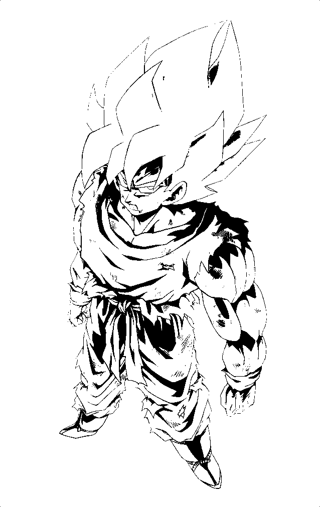

# 鎏光板绘 · LumiBoard

> 把插画变成会发光的 PCB 艺术品：从卡面设计到嘉立创下单的一站式「PCB 艺术卡牌工坊」。


**鎏光板绘**（LumiBoard，内部代号 Card Forge Studio / 卡牌工坊）是一个**纯前端、单文件、零依赖**的 PCB 艺术卡牌设计工具：在浏览器里完成卡面设计，一键把插画拆分为符合真实生产工艺的 **顶层铜 / 顶层阻焊 / 底层阻焊 / 彩色丝印** 图层，生成嘉立创EDA 专业版放置脚本按真实毫米尺寸 1:1 落板，导出即可下单打样。

名字由来：**鎏**＝沉金（ENIG）工艺的金色，**光**＝背光透出的画面，**板**＝PCB 电路板（也谐「板绘」），**绘**＝创作。

---

## ✨ 功能特性

### 🎨 卡面设计
- **单卡设计 / 批量生产** 双模式，生产线总览一目了然
- 角色图片、卡面文案、稀有度配色、背景边框、漫画分镜拼贴、图标贴纸
- 字体样式与大小、合成特效与调色、角色摆放、元素显示/删除、快捷操作

### 🏭 多层图层 1:1 导出（工艺路线版）
- 一键拆板：**顶层铜 / 顶层阻焊 / 底层阻焊 / 彩色丝印** 四层
- 极性与真实生产一致：铜/丝印＝正片（黑＝有图元），阻焊＝负片（黑＝开窗）
- **分层 PNG（ZIP）导出**，可附板框轮廓参考图
- 生成嘉立创EDA 专业版「高级 → 运行脚本」脚本：四层按设定 mm 尺寸 **1:1 放置**，四角带对齐锚点保证重合

### 🔬 成品效果模拟
- **沉金金属浮雕**：方向光 + 浮雕法线 + 镜面高光，呈现雕刻金属质感
- **背光透光**：非线性透光曲线，亮部透光、暗部遮光，模拟真实点灯效果
- **彩色丝印半透叠印**：背光区油墨作为透色片，颜色与背光/金属光泽共存
- 阻焊颜色、表面处理即时切换预览

### ✅ 工艺校验（DRC）与下单参数
- 最小线宽检查（≥0.15mm，DPI 建议 ≤169）
- 路线专属校验：透光画板厚、彩色丝印「白阻焊 + 沉金」硬性要求、层映射冲突提示
- 自动生成下单参数摘要（阻焊颜色 / 表面处理 / 板厚）

---

## 🛠 工艺路线（选定后自动套用层映射与下单参数）

| 工艺路线 | 效果定位 | 顶层铜 | 顶层阻焊 | 底层阻焊 | 彩色丝印 | 默认下单参数 |
| --- | --- | --- | --- | --- | --- | --- |
| 透光画（背光） | 背光点亮的透光画 | 暗区留铜（遮光） | 亮区开窗 | 镜像顶阻焊（双面透光） | 不导出 | 哑黑阻焊 · 沉金 ENIG · 板厚 0.8mm |
| 金属浮雕 | 沉金金属光泽画面 | 亮区留铜 | 亮区开窗 | 不导出 | 不导出 | 哑黑阻焊 · 沉金 ENIG · 板厚 1.6mm |
| 彩色丝印 | 全彩印刷画面 | 不导出 | 不导出 | 不导出 | 彩色位图丝印 | 哑白阻焊 · 沉金 ENIG · 板厚 1.6mm |
| 彩印+沉金混合 | 暗区露沉金 + 彩色丝印 + 背光 | 暗区留铜 | 暗区开窗 | 不导出 | 彩色位图丝印 | 哑白阻焊 · 沉金 ENIG · 板厚 1.6mm |
| 自定义 | 手动映射各层 | 自选 | 自选 | 自选 | 自选 | 自选 |

> 选定路线后自动套用：图层映射、明暗阈值、矢量化容差、简化、反转明暗、背光点亮等全部参数；手动改动任一映射即自动切回「自定义」。

---

## 🚀 快速开始

1. 下载 `LumiBoard.html`，用浏览器直接打开（推荐 Chrome / Edge）
2. **无需安装、无需联网、无需构建**，全部逻辑与图标均内嵌于单个 HTML 文件
3. （可选）将文件重命名为 `index.html`，即可通过 GitHub Pages 在线分享

## 📖 完整工作流

1. **设计卡面**：上传角色图，排版文案、边框、贴纸，完成调色
2. **设定物理尺寸**：宽/高 mm（或「尺寸跟随卡牌」）
3. **选择工艺路线**：一键自动套用层映射与下单参数
4. **预览验证**：分层预览 + 成品效果模拟 + DRC 工艺校验
5. **导出**：分层 PNG（ZIP）
6. **落板**：生成 EDA 放置脚本 → 嘉立创EDA 专业版 → 高级 → 运行脚本 → 粘贴运行
7. **下单**：按「下单参数摘要」在嘉立创填写阻焊颜色、表面处理、板厚

## 🧾 下单参数速查

- **彩色丝印**：必须使用 **白色阻焊 + 沉金 ENIG**（嘉立创彩色丝印工艺硬性要求，否则偏色发黑）
- **透光画**：板厚建议 **0.6~0.8mm**（FR-4 透光性随厚度衰减）
- **最小线宽 ≥0.15mm**，导出 DPI 建议 ≤169
- 最终以嘉立创工艺审核结果为准

## 📁 项目结构

```
艺术卡牌制作/
├── LumiBoard.html              # 主程序（单文件：样式 / 脚本 / 图标全部内嵌）
├── LICENSE                     # MIT 许可证
├── README.md                   # 项目说明（本文件）
├── 多层图层导出_使用说明.txt    # 多层导出功能速览
└── docs/
    ├── images/                 # 导出示例（孫悟空 54×85.6mm 分层图 + EDA 放置脚本）
    └── PCB_textures/           # 12 组 PCB 纹理素材（SVG 矢量 + 黑铜 PNG）
```

## 🔧 技术说明

- 纯 HTML + CSS + 原生 JavaScript，**零依赖、零构建**
- Canvas 2D 逐像素合成：层映射、分层预览、成品模拟均在本地完成
- 界面图标全部 base64 内嵌，无外部资源请求
- 兼容现代桌面浏览器（Chrome / Edge / Firefox / Safari）

## 📸 示例输出

以「彩印 + 沉金混合」路线导出的一套真实分层图（孫悟空，54 × 85.6 mm）：

| 顶层铜（黑 = 留铜） | 彩色丝印 | 顶层阻焊（黑 = 开窗） |
| :---: | :---: | :---: |
|  |  |  |

- 板框轮廓参考图与下单说明：[docs/images/PCB分层图_孫悟空_54x85.6mm/](docs/images/PCB分层图_孫悟空_54x85.6mm/)
- 嘉立创EDA 放置脚本示例：[docs/images/EDA多层脚本_孫悟空_54x85.6mm.js](docs/images/EDA多层脚本_孫悟空_54x85.6mm.js)
- 纹理素材（菱形镶嵌 / 对偶平铺等 12 组）：[docs/PCB_textures/](docs/PCB_textures/)，含预览图与生成流程说明

## 🗺 Roadmap

- [ ] 更多工艺路线预设
- [ ] Gerber 直接导出 / 拼板支持
- [ ] 卡面模板市场
- [ ] 英文界面

## 🤝 贡献

欢迎提交 Issue 与 Pull Request：新的工艺路线参数、更真实的材质模拟、UI/交互改进，都是极好的切入点。

## ⚠️ 免责声明

本工具生成的分层图与脚本仅供参考学习，实际下单生产前请以嘉立创工艺审核与 DRC 检查结果为准；因使用本工具产生的生产问题，作者不承担相关责任。

## 📄 License

[MIT](LICENSE) © 2026 鎏光板绘 Contributors
